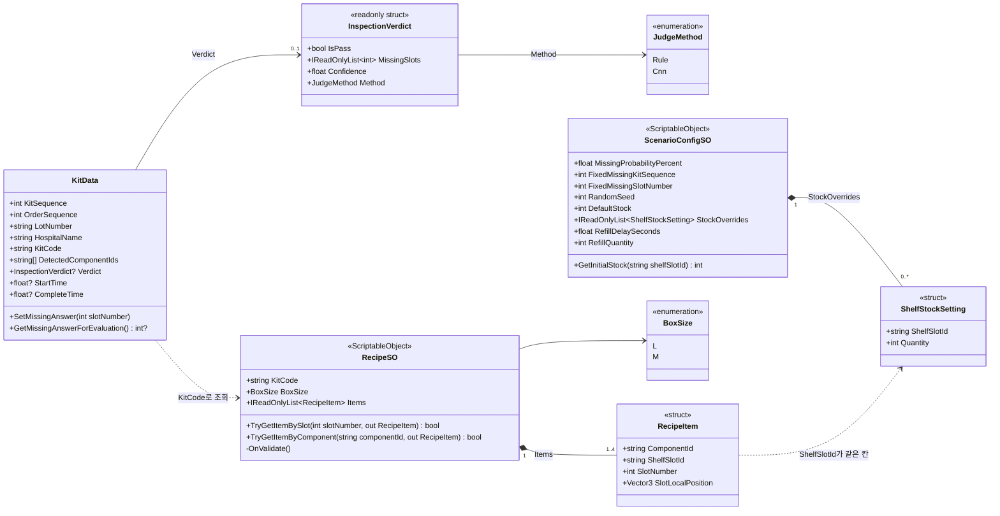
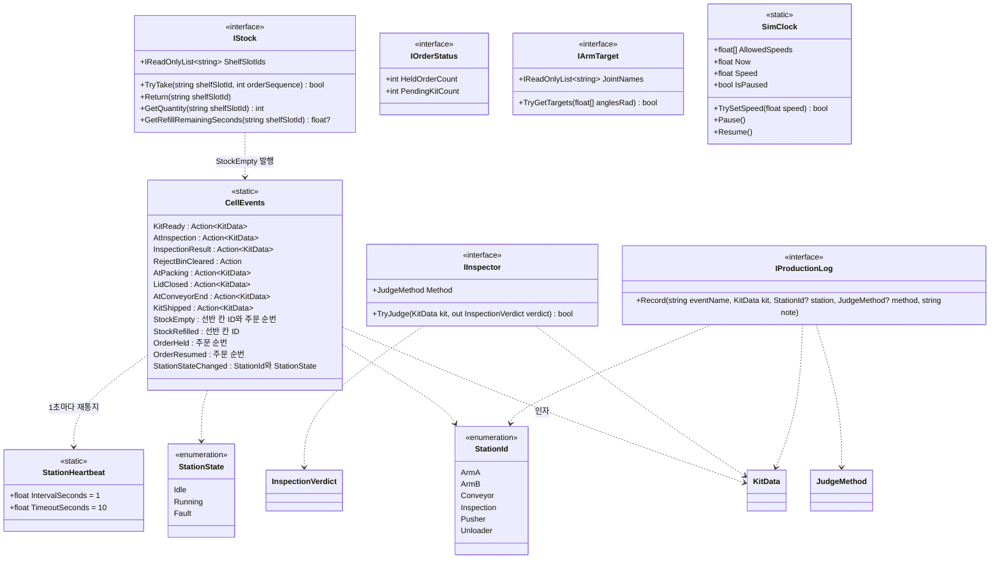
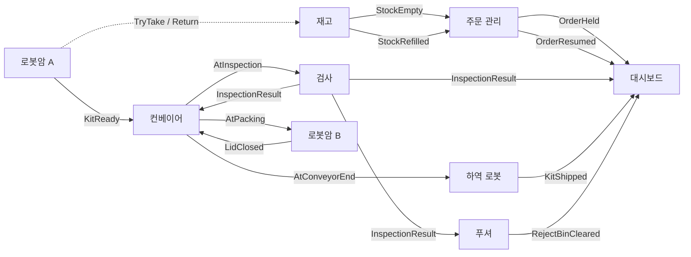

# 클래스 다이어그램

> 근거: `docs/INTERFACES.md`, 코드 `Assets/_Project/Scripts/Common/`, `Assets/_Project/Scripts/Recipes/`
> 범위: 지금 구현된 공통 인터페이스와 레시피. 설비(로봇암, 컨베이어, 검사 등)는 구현 후 추가한다.
> GitHub에서 열면 다이어그램이 그림으로 보인다.

## 1. 데이터 클래스

키트 한 개가 만들어져 판정되기까지의 데이터와 레시피, 시나리오 설정의 관계이다.

- `KitData.KitCode`와 `RecipeSO.KitCode`는 같은 대문자 문자열이다. 주문 관리가 이 코드로 레시피를 찾는다.
- `DetectedComponentIds[슬롯 번호 - 1]`이 감지된 구성품 ID이고, 빈 슬롯은 `null`이다. 판정의 `MissingSlots`와 누락 정답은 같은 슬롯 번호 체계를 쓴다.
- 레시피 한 개의 구성품은 최대 4개이고, 선반 칸 ID의 열 번호가 피킹 순서와 같다.

## 2. 설비 사이의 접점

설비는 서로 직접 참조하지 않고 `CellEvents`와 아래 인터페이스로만 연결된다. 구현 클래스는 앞으로 만든다.

- `CellEvents.RaiseInspectionResult`는 `KitData.Verdict`가 비어 있으면 신호를 보내지 않는다.
- `IInspector.TryJudge`가 `false`이면 호출하는 쪽이 규칙 판정기로 대체한다. (FR-07)
- 시간은 모두 `SimClock.Now`를 읽는다. 예외는 `StationHeartbeat`와 ROS 발행 주기이다.

## 3. 구현 예정 클래스와 연결 (참고)

| 구현 예정 | 구현할 인터페이스·역할 | 발행하는 신호 | 구독하는 신호 |
|---|---|---|---|
| 재고 (`Stock`) | `IStock` | `StockEmpty`, `StockRefilled` | - |
| 주문 관리 (`OrderManager`) | `IOrderStatus` | `OrderHeld`, `OrderResumed` | `StockEmpty`, `StockRefilled` |
| 로봇암 A | `IArmTarget` 사용 | `KitReady` | - |
| 규칙 판정기 / CNN 판정기 | `IInspector` | - | - |
| 검사 | 판정기 호출 후 `Verdict` 채움 | `InspectionResult` | `AtInspection` |
| 컨베이어 | - | `AtInspection`, `AtPacking`, `AtConveyorEnd` | `KitReady`, `InspectionResult`, `LidClosed` |
| 푸셔 | - | `RejectBinCleared` | `InspectionResult` |
| 하역 로봇 | - | `KitShipped` | `AtConveyorEnd` |
| 대시보드 | `IStock`, `IOrderStatus` 조회 | - | 대부분의 신호 |
| 로거 | `IProductionLog` 구현 | - | 대부분의 신호 |

## 4. 신호 흐름 (정상, 누락, 재고 소진)

